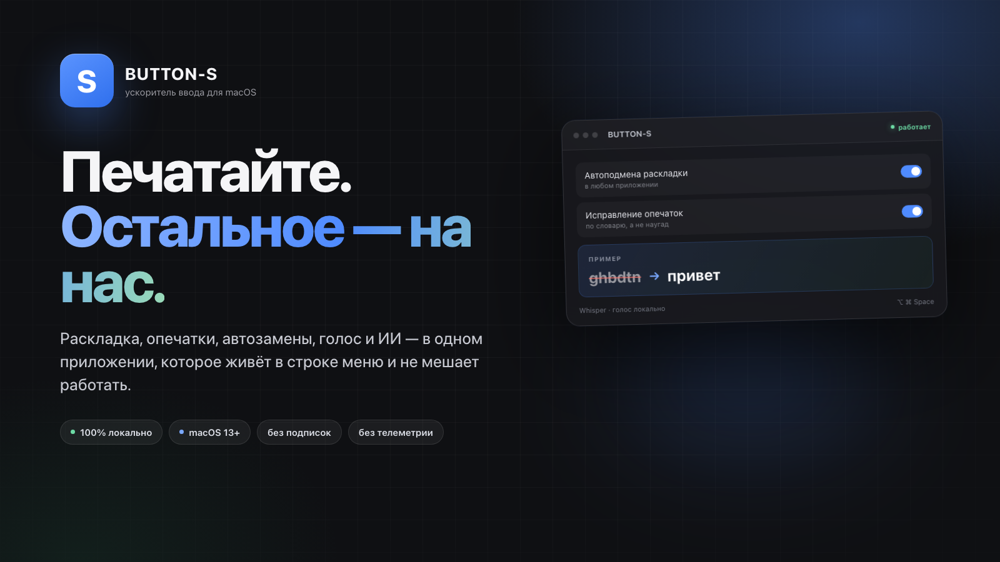
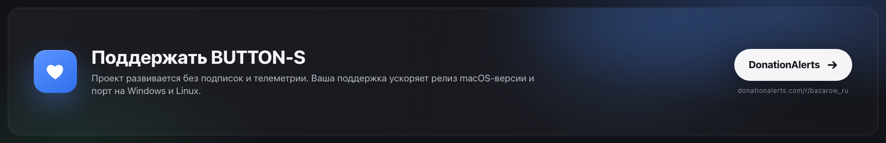
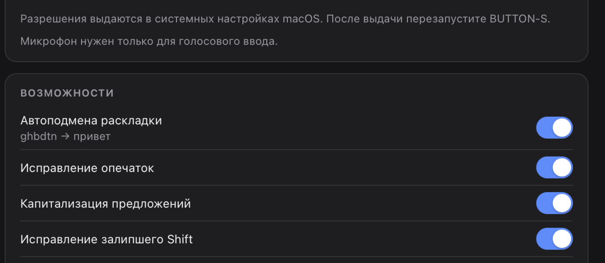
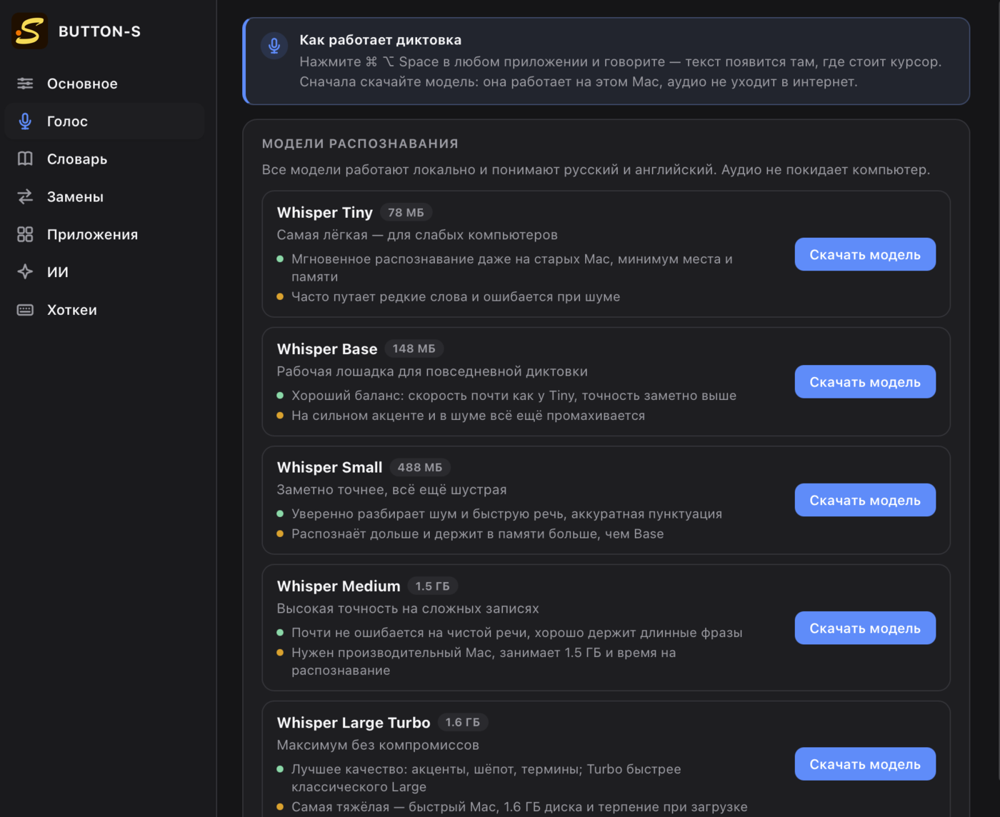
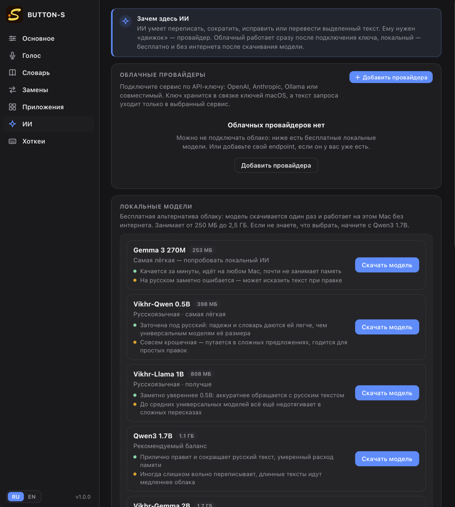
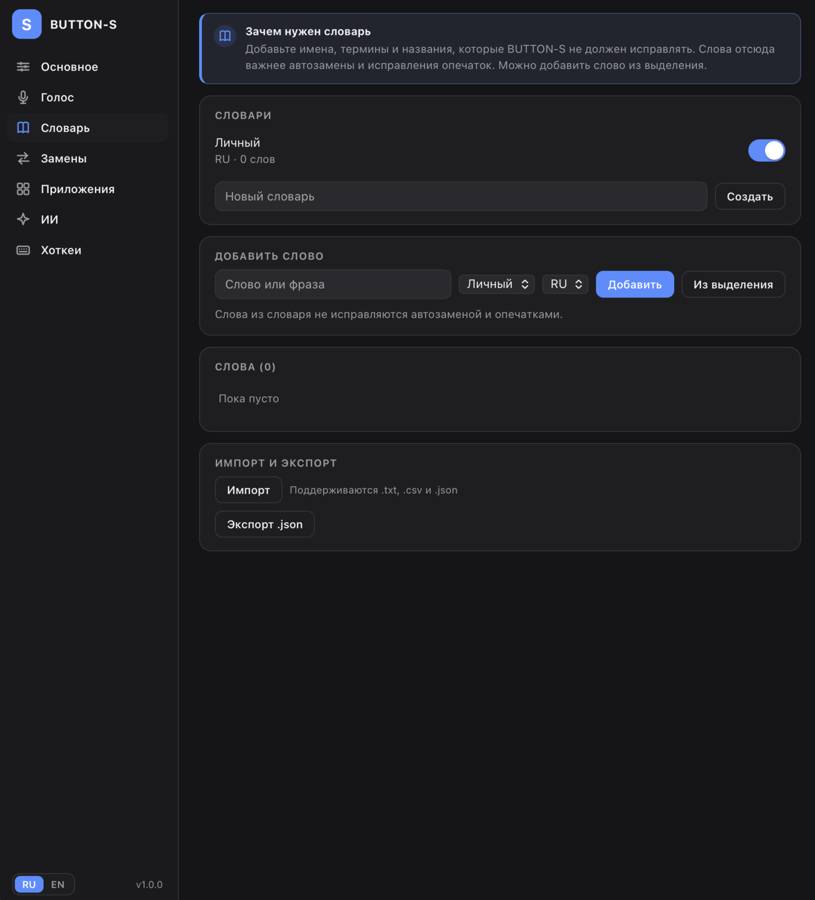
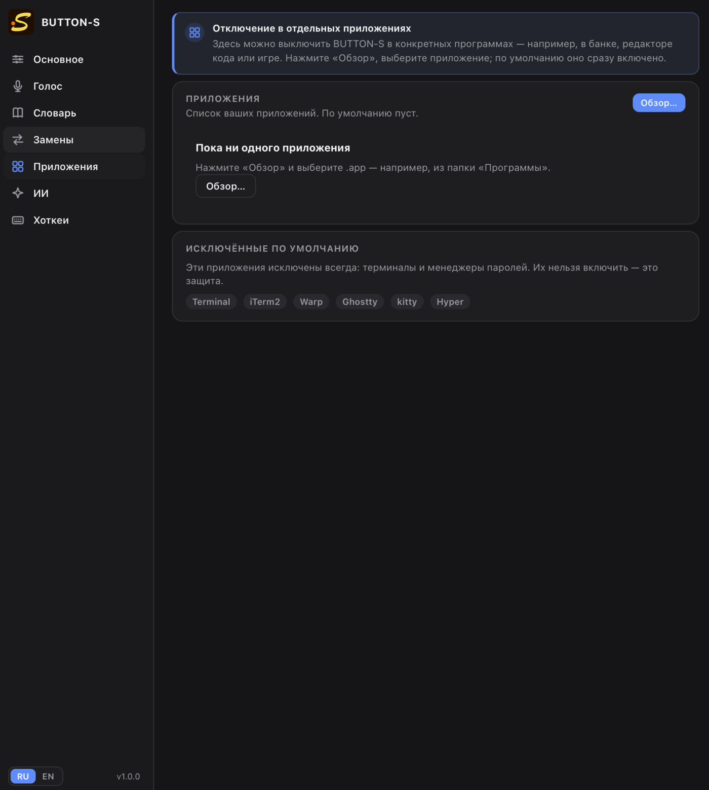

<p align="center">
  
</p>

# BUTTON-S

**Печатайте в любом приложении — BUTTON-S исправляет раскладку, опечатки и берёт на себя рутину.**

BUTTON-S — небольшой фоновый помощник для macOS и Windows, который живёт в строке меню и не занимает Dock. Он понимает, что вы набрали не в той раскладке, исправляет опечатки, продолжает списки, подсказывает голосом и работает с текстом через ИИ. Всё это — поверх любых приложений: браузера, мессенджера, редактора, почты.

**Версия 1.2.0 · macOS 13+ (Apple Silicon) · Windows 10/11 x64 · Linux — следом · без подписок · без телеметрии.**

> **Платформы.** Релиз **1.2.0** для **macOS** и **Windows** опубликован:
> [BUTTON-S 1.2.0](https://gitverse.ru/mibazarow/Button-S-local-corrector/releases/tag/v1.2.0).
> Linux — следующий этап. Официальные сборки и исходники — в этом репозитории.

<p align="center">
  <a href="https://www.donationalerts.com/r/bazarow_ru">
    
  </a>
</p>
<p align="center">
  <b>Поддержать проект:</b> <a href="https://www.donationalerts.com/r/bazarow_ru">DonationAlerts</a> —
  это ускоряет развитие приложения и порт на Linux.
</p>

> **Про тесты на Windows.** Автор работает только на macOS, поэтому Windows-сборка проверена сборкой и запуском в виртуалке — без GPU и полноценного рабочего стола. Если у вас есть неиспользуемый Windows-компьютер, его можно передать в дар или на время для тестов. Поддержать покупку самого простого ПК можно через [DonationAlerts](https://www.donationalerts.com/r/bazarow_ru). Это не условие пользования и не просьба — просто возможность помочь проекту.

## Проблема

Мы печатаем быстро и постоянно спотыкаемся об одно и то же:

- набрали `ghbdtn`, а нужен «привет»;
- переключили раскладку и не заметили;
- слово с опечаткой ушло клиенту;
- Shift залип, и половина слова — ЗАГЛАВНЫМИ;
- список после Enter пришлось начинать вручную;
- нужно быстро переписать или перевести выделенный текст, а не открывать ещё одну вкладку.

Мелочи. Но их много, и они съедают внимание каждый день.

## Решение

BUTTON-S встраивается в ввод на уровне macOS и исправляет это **на месте**, пока вы печатаете. Никаких копирований, вставок и переключений окна: набрали слово, поставили пробел — текст уже исправлен.

Приложение не мешает: его нет в Dock, настройки открываются из строки меню, а все функции можно выключить одним тумблером.

## Почему BUTTON-S

- **Работает в любом приложении.** Браузер, Telegram, Slack, VS Code, почта, заметки — везде, где есть текстовый курсор.
- **Локально и приватно.** Словари, модели Whisper и локальные LLM работают на вашем Mac. Приложение не имеет своего сервера, не собирает телеметрию и не отправляет текст без вашего явного выбора облачного провайдера.
- **Не мешает.** Живёт в строке меню, не занимает Dock, не перехватывает управление. В защищённых полях и менеджерах паролей отключается автоматически.
- **Экономит время.** Одна автозамена раскладки уже убирает десятки раздражающих правок в день. Опечатки, капитализация, списки и хоткеи — сверху.
- **Голос без облака.** Whisper распознаёт русскую и английскую речь локально. Аудио не покидает компьютер.
- **ИИ — по желанию.** Подключите облачный сервис по своему ключу или скачайте локальную модель и работайте офлайн. Ключи хранятся в системном хранилище секретов (Keychain / Credential Manager).
- **Настраивается под вас.** Личный словарь, исключения для отдельных приложений и горячие клавиши.

## Что умеет

### Автоподмена раскладки

Набрали `ghbdtn` — после пробела получилось `привет`. Набрали `руддщ` — получилось `hello`. BUTTON-S смотрит на слово, проверяет его по частотным словарям RU/EN и меняет раскладку только тогда, когда это действительно нужно. Раскладка переключается автоматически.

Есть и ручной режим: выделите слово или текст и нажмите хоткей.


*Один экран настроек: включить нужное можно одним тумблером.*

### Опечатки и порядок в тексте

- Исправление опечаток по словарю, а не наугад.
- Капитализация после точки, восклицательного и вопросительного знака.
- Исправление залипшего Shift: `ППривет` → `Привет`.
- Продолжение списков: `1.`, `2.`, `a)`, `-`, `•`.
- Отмена последнего исправления одним хоткеем.

Порядок работы предсказуемый: сначала опечатки, потом раскладка.

### Голосовой ввод

Удерживайте **Right Shift** и говорите — текст появится там, где стоит курсор. Отпустите клавишу — текст вставится. Поддерживаются режимы «удерживать клавишу», «нажал — говоришь» и авто-остановка по тишине.

Right Shift назначен по умолчанию; для заглавных букв удобнее использовать левый Shift. Комбинацию можно изменить в настройках голоса.

Пять моделей Whisper — от лёгкой Tiny до Large Turbo. Модель скачивается один раз и работает локально; аудио не отправляется в интернет. Язык — русский, английский или автоопределение.


*Whisper Tiny, Base, Small, Medium и Large Turbo — под разное железо и задачи.*

### ИИ и перевод

ИИ умеет переписать, сократить, исправить или перевести выделенный текст. Есть два пути:

- **облачный провайдер** — OpenAI-совместимый сервис, Anthropic или Ollama по вашему API-ключу;
- **локальная модель** — скачивается один раз и работает без интернета.

Встроенные действия: «Исправить орфографию», «Сократить», «Переписать официально», «Суммировать», «Ответить на письмо». Можно добавить свои промпты, назначить им хоткеи и выбрать, куда выводить результат: заменить выделение, показать в окне, скопировать или дописать.


*Облако или локальная модель — переключается в один клик. Всё, что нужно, объяснено прямо на экране.*

### Быстрые действия у выделения

Выделите текст в любом редактируемом поле — в конце выделения появится иконка BUTTON-S. Наведите на неё: откроется компактное меню с частыми действиями — исправить грамматику, сделать официальным или простым, сократить, суммировать, переписать, оформить списком, перевести RU ↔ EN.

Внизу меню есть поле **«Что сделать с текстом?»**: напишите свой запрос и нажмите Enter. Результат заменит выделенный текст.

Действия используют активный ИИ-провайдер: облачный сервис или скачанную локальную модель. Для работы нужен Accessibility.

### Личный словарь

Добавьте имена, термины, названия компаний и всё, что BUTTON-S не должен исправлять. Слова из словаря имеют приоритет над опечатками и исправлением раскладки.

Словарь пополняется сам, без вопросов и подтверждений. Если вы три раза подряд отменили автозамену, слово или пара «опечатка → исправление» уходит в исключения. Обратное тоже работает: если вы три раза вручную исправили слово так, как предлагала автозамена, исключение снимается и автоисправление возвращается.


*Личный словарь: имена и термины, которые приложение не трогает.*

### Исключения для приложений

Не хотите, чтобы BUTTON-S работал в банковском приложении или редакторе кода? Нажмите «Обзор», выберите `.app` — и выключите его одним тумблером.

Терминалы и менеджеры паролей исключены всегда: это защита, а не настройка.


*Список приложений пуст, пока вы сами не добавите нужное.*

## Горячие клавиши

| Действие | По умолчанию |
|---|---|
| Конвертировать последнее слово | `Ctrl+Alt+Z` |
| Конвертировать выделение | `Ctrl+Alt+L` |
| Отменить последнюю замену | `Ctrl+Alt+Backspace` |
| Диктовка | `RShift` (удерживать) |
| Перевести RU → EN | `Ctrl+Alt+T` |
| Перевести EN → RU | `Ctrl+Alt+R` |
| Исправить текст через ИИ | `Ctrl+Alt+F` |
| Пауза всех функций | `Ctrl+Alt+P` |
| Меню действий над выделением | `Ctrl+Alt+M` |

Сочетания одинаковы на macOS и Windows и меняются в настройках. Для голоса и ИИ хоткей можно записать прямо в соответствующем разделе.

## Приватность и безопасность

- **Нет собственного сервера.** BUTTON-S не собирает статистику и не отправляет текст «куда-то» по умолчанию.
- **Локальные модели.** Whisper и локальные LLM работают на вашем Mac; аудио и текст не уходят в облако.
- **Облако — только по вашему выбору.** Если вы подключили провайдера, запрос уходит только ему. Ключи хранятся в системном хранилище секретов и не попадают в конфиг.
- **Защищённые поля.** В полях с secure input ввод не буферизуется и не исправляется.
- **Менеджеры паролей** исключены из всех функций.
- **История в интерфейсе не ведётся.**
- **Никакой телеметрии и скрытых сетевых запросов.**

Подробнее — в [SECURITY.md](SECURITY.md).

## Для кого

- Тем, кто много печатает и устал от раскладки и опечаток.
- Тем, кто работает в браузере, мессенджерах, почте и редакторах кода.
- Тем, кто хочет голосовой ввод и ИИ, но не хочет отправлять рабочий текст в облако.
- Тем, кто ценит нативный macOS-интерфейс без тяжёлых подписок и лишних окон.

## Установка

**Требования:** macOS 13+ (Apple Silicon) или Windows 10/11 x64. Приложение работает в строке меню / трее.

1. Скачайте DMG (macOS) или ZIP с установщиком (Windows) из раздела **Releases** этого репозитория.
2. macOS: откройте DMG и перетащите **BUTTON-S** в `Applications`. Windows: распакуйте ZIP и запустите `BUTTON-S_1.2.0_x64-setup.exe`.
3. Запустите приложение. Сборка не нотаризована, поэтому при первом запуске может понадобиться правый клик → **Открыть**.
4. Выдайте разрешения:
   - **Универсальный доступ** — чтобы вставлять исправленный текст;
   - **Мониторинг ввода** — чтобы перехватывать клавиатуру;
   - **Микрофон** — только для диктовки.
5. Перезапустите BUTTON-S, если система попросит разрешения (Accessibility / Input Monitoring / микрофон или SmartScreen).
6. Проверьте: наберите `ghbdtn` и поставьте пробел — должно получиться `привет `.

Модели Whisper (от 78 МБ до 1,6 ГБ) и локальные LLM (от 250 МБ до 2,5 ГБ) скачиваются отдельно, по вашему действию. В установщик они не входят.

Как проверять и ставить новые версии вручную — [UPDATES.md](UPDATES.md).

## Техническая основа

- **Tauri 2** + **Rust** — нативный бэкенд, перехват ввода и инъекция через CGEvent.
- **Svelte 5 (runes)** + **TypeScript** + обычный CSS — интерфейс без тяжёлых UI-фреймворков.
- **Whisper** через `whisper-rs` — локальное распознавание речи.
- **llama.cpp** через `llama-cpp-2` — локальные LLM.
- **SQLite** — локальные данные; **Keychain** — секреты.

## Сборка из исходников

Нужны Node.js 20+, Rust stable, Xcode Command Line Tools и CMake (для `llama-cpp-2` и `whisper-rs`).

```bash
npm install
npm run tauri dev
```

Проверки:

```bash
npm run check
npm run build
cargo test --manifest-path src-tauri/Cargo.toml
cargo clippy --manifest-path src-tauri/Cargo.toml --all-targets
npx tauri build
```

Release-сборка создаёт `.app` и `.dmg` в `src-tauri/target/release/bundle/`.

## Что дальше

- Полировка UX по реальному использованию.
- Linux — следующий этап; Windows 1.2.0 уже в релизе (CPU-инференс, без Vulkan).
- Живая проверка Windows на реальном железе: хук, хоткеи и диктовка вне виртуалки.
- Больше локальных моделей и сценариев для ИИ.
- Автообновление и подпись релизов.

## Лицензия и участие

BUTTON-S распространяется по модели **source-available**: исходники открыты для просмотра и изучения, но это не open-source-проект.

- **Официальные сборки** можно бесплатно использовать в любых целях, включая коммерческие.
- **Модификация** приложения и **перепродажа/лицензирование** его или изменённых версий требуют предварительного письменного разрешения автора.
- **Авторство обязательно:** `BUTTON-S by Михаил Базаров (https://bazarow.ru)`.

- Полный текст: [LICENSE.md](LICENSE.md)
- Безопасность: [SECURITY.md](SECURITY.md)
- Как участвовать: [CONTRIBUTING.md](CONTRIBUTING.md)
- Кодекс поведения: [CODE_OF_CONDUCT.md](CODE_OF_CONDUCT.md)
- Лицензии сторонних словарей: [NOTICE.txt](NOTICE.txt)
